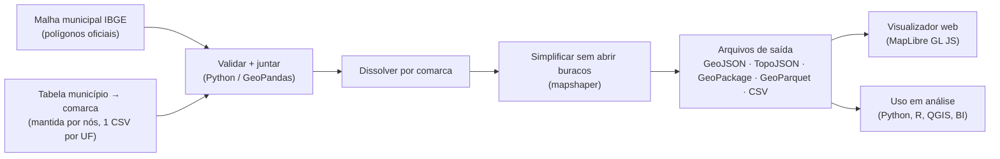

# 01 — Arquitetura e tecnologias

> **Status:** proposta em discussão (fase 0 — definição).
> Este documento registra *o que* vamos usar e, principalmente, *por quê*.
> Quando uma decisão mudar, atualize este arquivo no mesmo commit da mudança.

## 1. Contexto: o problema real não é desenhar o mapa, é conseguir os dados

- **Comarca** é a unidade territorial da Justiça Estadual. Quem define as comarcas é
  cada um dos 27 Tribunais de Justiça (TJs), por meio da lei de organização judiciária
  do seu estado.
- **Não existe um arquivo oficial nacional** (shapefile/GeoJSON) com os limites das
  comarcas. O IBGE publica os limites dos municípios, mas não os das comarcas.
- Segundo o relatório *Justiça em Números* (CNJ), cerca de metade dos ~5.570
  municípios brasileiros é **sede** de comarca. Os demais pertencem a uma comarca
  vizinha (são os "termos" ou "municípios jurisdicionados").

### A ideia central

> **Uma comarca é (quase sempre) a união de municípios inteiros.**

Então não vamos desenhar fronteiras à mão. Vamos manter uma **tabela** dizendo a qual
comarca cada município pertence e **calcular** o polígono de cada comarca juntando
("dissolvendo") os polígonos oficiais dos municípios do IBGE.



Consequências dessa escolha:

1. **A fonte da verdade é uma tabela pequena e legível**, versionada no Git. Corrigir uma
   comarca = editar uma linha de CSV e abrir um pull request.
2. **As bordas batem perfeitamente** com as dos municípios e estados, porque vêm da mesma
   malha oficial.
3. **Replicável:** qualquer pessoa regenera todo o mapa com um comando, a partir da malha
   do IBGE + nossas tabelas.
4. **Integração fácil com estatísticas:** quase todo dado público brasileiro tem o código
   IBGE do município, então ele "cai" automaticamente na comarca certa.

## 2. Decisões de tecnologia

| Camada | Escolha | Por quê | Alternativas descartadas (e motivo) |
|---|---|---|---|
| Linguagem do pipeline de dados | **Python 3.12+** | Ecossistema geoespacial mais maduro; mesma linguagem que muitos usuários de estatística já usam. | R/`geobr` (ótimo, mas menos comum para integração com sistemas); Node puro (fraco para validação de dados). |
| Gerenciador de dependências Python | **uv** (com `uv.lock`) | Rápido e gera *lockfile*: todos instalam exatamente as mesmas versões → reprodutibilidade. | pip + requirements.txt (sem lock confiável); conda (pesado). |
| Manipulação geoespacial | **GeoPandas + Shapely 2 + pyogrio** | Leitura do shapefile do IBGE, junção com a tabela, *dissolve* por comarca, validação de geometrias. | PostGIS (exige servidor de banco; desnecessário para um conjunto de dados estático). |
| Simplificação e TopoJSON | **mapshaper** (CLI via npm) | Simplifica **preservando a topologia**: vizinhos continuam encostados, sem frestas nem sobreposição. Gera TopoJSON nativamente. | `simplify()` do GeoPandas (simplifica cada polígono isoladamente → abre frestas entre vizinhos). |
| Orquestração | **Makefile** chamando scripts Python | Um comando (`make tudo`) refaz tudo; cada etapa pode ser rodada sozinha. | Airflow/Prefect (exagero para um pipeline linear). |
| Testes e validação | **pytest** | As regras de qualidade (doc 02) viram testes automáticos. | — |
| Visualizador web | **MapLibre GL JS + TypeScript + Vite** | Open source, sem chave de API, renderiza milhares de polígonos via WebGL, estilo guiado por dados (ideal para mapas coloridos por indicador), suporta PMTiles. | Leaflet (mais simples, porém mais lento com milhares de polígonos e sem estilo por dados nativo); Google Maps/Mapbox (pagos e com chave). |
| Forma de integração do front | **Módulo TS independente de framework** (`criarMapaComarcas(elemento, opções)`) | Pode ser usado em HTML puro, React, Vue, Angular… sem amarrar o projeto a um framework. | Componente React (excluiria quem não usa React). |
| Mapa de fundo | **Nenhum obrigatório** (fundo neutro + nossas próprias camadas) | Zero dependência externa e zero custo. Mapa de fundo (ex.: OpenFreeMap) fica opcional. | — |
| Automação | **GitHub Actions** | Valida cada pull request; ao criar uma versão, gera os arquivos e publica. | — |
| Distribuição | **GitHub Releases** (arquivos) + **GitHub Pages** (demo) | Gratuito e estático. Arquivos gerados grandes não entram no Git. | Servidor próprio (custo e manutenção). |
| Tiles vetoriais (fase futura) | **PMTiles** gerado com **tippecanoe** | Um único arquivo estático com todos os níveis de zoom; só necessário quando quisermos detalhe máximo no zoom. | Servidor de tiles (custo e manutenção). |

> **Por que começar sem PMTiles?** Com ~2.600 comarcas e ~5.570 municípios, uma
> versão simplificada em GeoJSON/TopoJSON tem poucos MB e o MapLibre carrega direto.
> PMTiles adiciona uma ferramenta compilada (tippecanoe) que só se paga quando
> precisarmos de bordas em resolução total no navegador.

## 3. Arquivos que o projeto vai entregar

| Arquivo | Para quem | Resolução |
|---|---|---|
| `municipio_comarca.csv` | Qualquer pessoa que queira cruzar dados por município (Excel, BI, SQL) | — (só tabela) |
| `comarcas.gpkg` (GeoPackage) | QGIS / ArcGIS / analistas GIS | Total (igual ao IBGE) |
| `comarcas.parquet` (GeoParquet) | Análise de dados (pandas, DuckDB, BigQuery) | Total |
| `comarcas_<resolucao>.geojson` | Uso universal na web | Média e baixa |
| `brasil_<resolucao>.topojson` (camadas: UFs, comarcas, municípios) | Web/D3: menor tamanho e bordas compartilhadas | Média e baixa |

Por que **GeoPackage** e não **shapefile**? O shapefile limita nomes de colunas a 10
caracteres, tem problemas de acentuação e é composto de vários arquivos soltos. O
GeoPackage é um arquivo único, padrão aberto (OGC), e abre em qualquer software GIS.

## 4. Sistemas de coordenadas

| Uso | Sistema | Observação |
|---|---|---|
| Dados de origem (IBGE) | SIRGAS 2000 (EPSG:4674) | Sistema geodésico oficial do Brasil. |
| Arquivos para web (GeoJSON/TopoJSON) | WGS 84 (EPSG:4326) | Exigido pelo padrão GeoJSON (RFC 7946). A diferença para o SIRGAS 2000 é desprezível na escala do mapa. |
| Cálculo de área | **Não calculamos**: somamos a área oficial que o IBGE publica para cada município | Evita divergência com o número oficial. Se um dia for preciso medir área, usar projeção de **áreas iguais** (Albers), nunca graus. |

## 5. Modelo de dados

### 5.1 Fontes mantidas por nós (`dados/fontes/<UF>/`)

Um par de arquivos por estado, para facilitar revisão e colaboração por TJ.

`comarcas.csv`

| Coluna | Exemplo | Regra |
|---|---|---|
| `comarca_id` | `3106200` | = código IBGE (7 dígitos) do município-sede. Único. |
| `nome` | `Belo Horizonte` | Nome oficial usado pelo TJ. |
| `uf` | `MG` | |
| `tribunal` | `TJMG` | |
| `entrancia` | `especial` | Valor como o TJ escreve (cada estado usa uma classificação). |
| `fonte` | URL ou "LC estadual nº X/AAAA, anexo Y" | Obrigatório. |
| `data_verificacao` | `2026-10-06` | Obrigatório (AAAA-MM-DD). |

`municipios.csv`

| Coluna | Exemplo | Regra |
|---|---|---|
| `codigo_ibge` | `3106200` | Deve existir na malha IBGE do ano de referência. Aparece uma única vez no país. |
| `municipio` | `Belo Horizonte` | Só para leitura humana; conferido contra o IBGE. |
| `comarca_id` | `3106200` | Deve existir em `comarcas.csv`. |

**Por que usar o código IBGE da sede como `comarca_id`?** Ele já existe, é estável, é
único (cada comarca tem uma sede e um município sedia no máximo uma comarca — hipótese
que o pipeline vai testar) e qualquer pessoa consegue cruzá-lo com outras bases.

### 5.2 Atributos das camadas geradas

- **comarcas:** `comarca_id`, `nome`, `uf`, `tribunal`, `entrancia`, `sede_ibge`,
  `n_municipios`, `area_km2`, `populacao`, `data_referencia`.
- **municipios:** `codigo_ibge`, `nome`, `uf`, `comarca_id`, `e_sede`.

## 6. Estrutura de pastas proposta

```
comarcas-brasil/
├── dados/
│   ├── fontes/<UF>/        # tabelas mantidas à mão (fonte da verdade) — versionadas
│   └── brutos/             # downloads do IBGE — fora do Git, regeneráveis
├── pipeline/               # Python: baixar → validar → dissolver → simplificar → exportar
├── tests/                  # regras de qualidade como testes (pytest)
├── dist/                   # arquivos gerados — fora do Git, publicados em Releases
├── web/                    # visualizador MapLibre + módulo reutilizável (TypeScript)
├── docs/                   # decisões e documentação
└── Makefile                # `make tudo` refaz tudo do zero
```

## 7. Exceções conhecidas (a tratar caso a caso)

| Caso | Tratamento inicial |
|---|---|
| **Distrito Federal**: o TJDFT se divide em *circunscrições* que seguem as Regiões Administrativas, ou seja, **dentro** de um único "município". | Fase 1: DF como um único polígono. Depois: usar limites das RAs (Geoportal do DF). |
| **Foros regionais** em capitais (ex.: São Paulo, Rio de Janeiro): subdivisões dentro de uma comarca. | Não são comarcas. Podem virar uma camada opcional futura. |
| **Polígonos especiais na malha IBGE** que não são municípios (ex.: Lagoa dos Patos e Lagoa Mirim, no RS). | Excluir das comarcas e listar no relatório de qualidade. |
| Município cujo distrito pertence a outra comarca. | Raro. Se aparecer, usar a malha de distritos do IBGE para aquele caso. |
| Agrupamentos acima da comarca (circunscrições, regiões judiciárias, polos). | Coluna opcional futura — útil para "divisão de territórios". |

## 8. Riscos

1. **Coleta de dados (maior risco e maior esforço):** 27 TJs, 27 formatos diferentes
   (páginas web, PDFs de leis, planilhas). Mitigação: começar com um estado piloto,
   usar bases existentes como ponto de partida (ex.: pacote `forosCNJ` da Associação
   Brasileira de Jurimetria, que relaciona foros a códigos IBGE) e validar cada UF contra
   a lista oficial do TJ.
2. **Dados envelhecem:** comarcas são criadas, extintas e agregadas. Mitigação:
   `data_verificacao` obrigatória, versões datadas (ex.: `v2026.10`) e re-verificação
   periódica.
3. **Acesso de rede:** o ambiente de nuvem atual bloqueia sites do IBGE e dos TJs; será
   preciso liberar esses domínios ou baixar os arquivos localmente.

## 9. Roteiro por fases

| Fase | Entrega | Critério de pronto |
|---|---|---|
| 0 — Definição | Este documento + métricas (doc 02) | Decisões aprovadas. |
| 1 — Esqueleto + piloto | Pipeline completo rodando para **1 UF** | Métricas do doc 02 verdes para a UF piloto. |
| 2 — Brasil inteiro | Tabelas das 27 UFs | Métricas verdes nacionalmente. |
| 3 — Visualizador | Demo web + módulo reutilizável | Metas de desempenho do doc 02. |
| 4 — Distribuição | Releases, GitHub Pages, CI | Build do zero em máquina limpa com um comando. |
| 5 — Extensões | PMTiles, DF por RA, foros regionais, agrupamentos, histórico | Sob demanda. |
