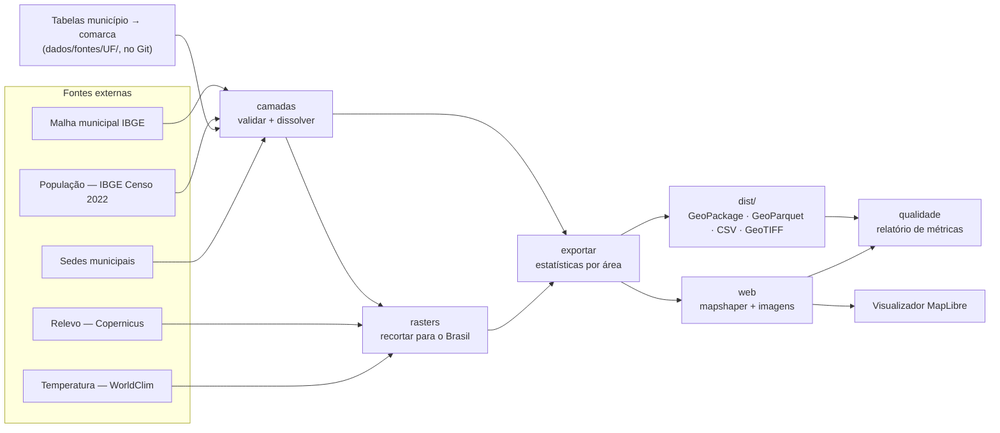

# 01 — Arquitetura e tecnologias

> **Status:** fase 1 implementada (pipeline + visualizador). Fase 2 em andamento:
> Roraima cadastrada como piloto.
> Este documento registra *o que* usamos e, principalmente, *por quê*.
> Quando uma decisão mudar, atualize este arquivo no mesmo commit da mudança.

## 1. Contexto: o problema real não é desenhar o mapa, é conseguir os dados

- **Comarca** é a unidade territorial da Justiça Estadual. Quem define as comarcas é
  cada um dos 27 Tribunais de Justiça (TJs), por meio da lei de organização judiciária
  do seu estado.
- **Não existe um arquivo oficial nacional** (shapefile/GeoJSON) com os limites das
  comarcas. O IBGE publica os limites dos municípios, mas não os das comarcas.
- Segundo o relatório *Justiça em Números* (CNJ), cerca de metade dos ~5.570
  municípios brasileiros é **sede** de comarca. Os demais pertencem a uma comarca
  vizinha (são os "termos" ou "municípios jurisdicionados").

### A ideia central

> **Uma comarca é (quase sempre) a união de municípios inteiros.**

Então não desenhamos fronteiras à mão. Mantemos uma **tabela** dizendo a qual comarca
cada município pertence e **calculamos** o polígono de cada comarca juntando
("dissolvendo") os polígonos oficiais dos municípios do IBGE. A mesma ideia gera os
estados, as regiões e o contorno do país.

Consequências:

1. **A fonte da verdade é uma tabela pequena e legível**, versionada no Git. Corrigir uma
   comarca = editar uma linha de CSV e abrir um pull request.
2. **As bordas batem perfeitamente** entre todas as camadas, porque vêm da mesma malha.
3. **Replicável:** qualquer pessoa regenera todo o mapa com um comando.
4. **Integração fácil com estatísticas:** quase todo dado público brasileiro tem o código
   IBGE do município, então ele "cai" automaticamente na comarca certa.

## 2. Catálogo de mapas

O projeto entrega dois tipos de mapa. Entender a diferença ajuda a escolher o certo:

- **Vetor** = formas geométricas (polígonos e pontos) com atributos. Bom para *limites*
  e para pintar áreas por um número (mapa coroplético).
- **Raster** = grade de pixels, cada um com um valor. Bom para fenômenos *contínuos*
  que não respeitam fronteiras, como altitude e temperatura.

| Mapa | Tipo | Origem | Chave | Atributos principais |
|---|---|---|---|---|
| País | vetor (área) | dissolve de todos os municípios | `nome` | área, população, densidade |
| Regiões | vetor (área) | dissolve pelo 1º dígito do código IBGE | `nome` | idem |
| Estados (`ufs`) | vetor (área) | dissolve por UF | `uf` | idem + `tem_comarcas` |
| Comarcas | vetor (área) | dissolve pela tabela município → comarca | `comarca_id` | nome, tribunal, entrância, sede, nº municípios, área, população |
| Municípios | vetor (área) | malha municipal IBGE | `codigo_ibge` | UF, região, comarca, sede de comarca?, área, população |
| Cidades | vetor (ponto) | sede de cada município | `codigo_ibge` | capital?, sede de comarca?, população |
| Relevo | raster | Copernicus DEM GLO-90 | — | altitude (m) |
| Temperatura | raster | WorldClim 2.1 (BIO1) | — | temperatura média anual (°C) |

> **Município × cidade:** município é o *território* inteiro (polígono, inclui a zona
> rural). Cidade, na definição do IBGE, é a *sede* urbana do município (um ponto).

### Ligando raster e vetor: estatísticas por área

Para usar relevo e temperatura como **métricas**, o pipeline calcula, para cada área
(município, comarca, estado, região, país), a **altitude média, mínima e máxima** e a
**temperatura média anual**. Para cada cidade, o valor no ponto da sede. Isso é feito
com o `exactextract`, que pondera pixels parcialmente cobertos (importante para
municípios menores que um pixel de temperatura).

## 3. Fluxo do pipeline



| Etapa | Comando | O que faz |
|---|---|---|
| baixar | `make baixar` | Baixa as fontes para `dados/brutos/` e registra o hash de cada arquivo |
| camadas | `make camadas` | Valida as tabelas de comarcas (para o build se houver erro) e monta as camadas vetoriais |
| rasters | `make rasters` | Lê o relevo direto da nuvem em resolução reduzida e recorta relevo e temperatura para o Brasil |
| exportar | `make exportar` | Calcula altitude/temperatura por área e grava os arquivos finais em `dist/` |
| web | `make web` | Simplifica as camadas, gera imagens WebP e o `catalogo.json` do visualizador |
| qualidade | `make qualidade` | Mede o resultado e escreve `dist/relatorio_qualidade.md` |

Todas as URLs, anos e resoluções ficam em **`config/fontes.toml`**. Trocar a malha de 2024
pela de 2025, por exemplo, é editar uma linha e rodar `make tudo`.

## 4. Decisões de tecnologia

| Camada | Escolha | Por quê | Alternativas descartadas (e motivo) |
|---|---|---|---|
| Linguagem do pipeline | **Python 3.11+** | Ecossistema geoespacial mais maduro; mesma linguagem de muita gente de estatística. | R/`geobr` (ótimo, mas menos comum para integração); Node puro (fraco para validação de dados). |
| Dependências Python | **uv** (com `uv.lock`) | Rápido e com *lockfile*: todos instalam exatamente as mesmas versões. | pip + requirements.txt (sem lock confiável); conda (pesado). |
| Vetores | **GeoPandas + Shapely 2 + pyogrio** | Leitura do shapefile do IBGE, junção com tabelas, dissolve, validação. | PostGIS (exige servidor; desnecessário para dados estáticos). |
| Rasters | **rasterio** (GDAL) + **NumPy** | Leitura remota de GeoTIFF otimizado para nuvem, reprojeção, recorte. | — |
| Estatísticas por área | **exactextract** | Pondera a fração de cada pixel coberta pelo polígono. | rasterstats (ignora pixels parciais → municípios pequenos ficam sem valor). |
| Simplificação e TopoJSON | **mapshaper** (npm) | Simplifica **todas as camadas juntas preservando a topologia**: vizinhos continuam encostados. | `simplify()` do GeoPandas (simplifica cada polígono isoladamente → abre frestas). |
| Orquestração | **Makefile** + `python -m pipeline` | Um comando refaz tudo; cada etapa pode rodar sozinha. | Airflow/Prefect (exagero para um pipeline linear). |
| Testes | **pytest** com dados sintéticos | Roda o pipeline inteiro sem internet, em segundos. | — |
| Visualizador | **MapLibre GL JS + TypeScript + Vite** | Open source, sem chave de API, WebGL, estilo guiado por dados. | Leaflet (mais lento com milhares de polígonos); Google Maps/Mapbox (pagos). |
| Integração do front | **Módulo `MapaBrasil` independente de framework** | Funciona em HTML puro, React, Vue, Angular… | Componente React (excluiria quem não usa React). |
| Mapa de fundo | **Nenhum obrigatório** | Zero dependência externa e zero custo. | — |
| Cores | Rampas sequenciais de **um só matiz** (`config/paletas.json`) | Claro = pouco, escuro = muito; legível por daltônicos; sem arco-íris. | Paleta arco-íris (cria fronteiras falsas e é ilegível para daltônicos). |

### Por que relevo do Copernicus lido "direto da nuvem"?

Os blocos do Copernicus são **COGs** (*Cloud Optimized GeoTIFF*): cada arquivo traz,
dentro dele, versões reduzidas da imagem ("overviews"). Quando pedimos uma grade pequena,
o GDAL baixa **só os bytes da versão reduzida**. Resultado: o relevo do Brasil inteiro
(816 blocos de 1°×1°) a ~1 km/pixel sai em cerca de 30 segundos, sem baixar os vários GB
da resolução total.

### Por que começar sem PMTiles?

Com ~5.570 municípios, a versão simplificada em TopoJSON tem cerca de 1 MB comprimido e o
MapLibre carrega direto. PMTiles (tiles vetoriais num arquivo único) só se paga quando
quisermos bordas em resolução total no navegador.

## 5. Arquivos entregues

| Arquivo | Para quem | Resolução |
|---|---|---|
| `dist/tabelas/municipio_comarca.csv` | Quem quer cruzar dados por município (Excel, BI, SQL) | — |
| `dist/tabelas/<camada>.csv` | Atributos de cada camada, sem geometria | — |
| `dist/brasil.gpkg` (GeoPackage, uma camada por mapa) | QGIS / ArcGIS | Total (igual ao IBGE) |
| `dist/parquet/<camada>.parquet` (GeoParquet) | pandas, DuckDB, BigQuery | Total |
| `dist/rasters/relevo.tif`, `temperatura_media_anual.tif` | GIS, análise | ~1 km e ~9 km |
| `dist/web/<resolucao>/<camada>.geojson` | Uso universal na web | Média (~250 m) e baixa (~2,5 km) |
| `dist/web/brasil_<resolucao>.topojson` | Web/D3: todas as camadas num arquivo, bordas compartilhadas | Média e baixa |
| `dist/web/relevo.webp`, `temperatura.webp` + `catalogo.json` | Visualizador | Imagens em Web Mercator |

Por que **GeoPackage** e não **shapefile**? O shapefile limita nomes de colunas a 10
caracteres, tem problemas de acentuação e é composto de vários arquivos soltos.

## 6. Sistemas de coordenadas

| Uso | Sistema | Observação |
|---|---|---|
| Dados de origem e `dist/` | SIRGAS 2000 (EPSG:4674) | Sistema geodésico oficial do Brasil. |
| Web e rasters | WGS 84 (EPSG:4326) | Exigido pelo GeoJSON (RFC 7946). Diferença desprezível para o SIRGAS 2000. |
| Imagens do visualizador | Web Mercator (EPSG:3857) | Projeção dos mapas da web; a imagem precisa estar nela para alinhar com os vetores. |
| Medir área | Albers do IBGE (`ALBERS_BRASIL` em `pipeline/config.py`) | Projeção de **áreas iguais**. Nunca medir área em graus. |
| Área oficial | Soma do `AREA_KM2` do IBGE | Evita divergência com o número oficial. |

## 7. Modelo de dados das comarcas

Detalhado em [`dados/fontes/README.md`](../dados/fontes/README.md). Resumo:

- `dados/fontes/<UF>/comarcas.csv`: `comarca_id` (= código IBGE da sede), `nome`, `uf`,
  `tribunal`, `entrancia`, `fonte`, `data_verificacao` e, opcional, `observacao`.
- `dados/fontes/<UF>/NOTAS.md`: fontes consultadas, decisões e pendências da UF.
- `dados/fontes/<UF>/municipios.csv`: `codigo_ibge`, `municipio`, `comarca_id`.

**Por que o código IBGE da sede como `comarca_id`?** Já existe, é estável, é único (cada
comarca tem uma sede e um município sedia no máximo uma comarca — o pipeline testa isso) e
qualquer pessoa consegue cruzá-lo com outras bases.

## 8. Estrutura de pastas

```
comarcas-brasil/
├── config/
│   ├── fontes.toml         # URLs, anos e resoluções de todas as fontes
│   └── paletas.json        # cores das métricas, do relevo e da temperatura
├── dados/
│   ├── fontes/<UF>/        # tabelas de comarcas (fonte da verdade, no Git)
│   ├── brutos/             # downloads (fora do Git)
│   └── intermediario/      # entre etapas (fora do Git)
├── pipeline/               # uma etapa por arquivo: baixar, camadas, rasters, exportar, web, qualidade
├── tests/                  # pipeline inteiro sobre um "Brasil de mentira"
├── dist/                   # arquivos finais (fora do Git; publicar em Releases)
├── web/                    # visualizador: src/mapa-brasil.ts (módulo) + src/main.ts (demo)
├── docs/
└── Makefile
```

## 9. Exceções conhecidas

| Caso | Tratamento atual |
|---|---|
| **Distrito Federal**: o TJDFT se divide em *circunscrições* dentro de um único "município". | DF como um polígono. Depois: limites das Regiões Administrativas (Geoportal DF). |
| **Foros regionais** em capitais. | Não são comarcas; camada opcional futura. |
| **Polígonos que não são municípios** na malha (Lagoa dos Patos e Lagoa Mirim, RS). | Configurados em `nao_municipios`: entram no contorno do estado, não na camada de municípios. |
| Município cujo distrito pertence a outra comarca. | Raro. Se aparecer, usar a malha de distritos do IBGE. |
| Agrupamentos acima da comarca (circunscrições, regiões judiciárias). | Coluna opcional futura. |
| **Comarca criada por lei, mas não instalada** (ex.: Cantá/RR). | O mapa mostra a jurisdição em funcionamento; a existência legal vai em `observacao`. |

## 10. Riscos

1. **Coleta das tabelas de comarcas (maior esforço):** 27 TJs, 27 formatos. Mitigação:
   estado piloto, ponto de partida no pacote `forosCNJ` (ABJ), validação automática.
2. **Dados envelhecem:** `data_verificacao` obrigatória, aviso após 12 meses (A9).
3. **Acesso de rede:** o ambiente de nuvem usado no desenvolvimento bloqueia IBGE,
   WorldClim e sites dos TJs. Localmente não há esse problema.
4. **Fonte das cidades:** coordenadas vêm de base comunitária (`kelvins/municipios-brasileiros`);
   trocar por IBGE Localidades 2022 quando possível.

## 11. Roteiro

| Fase | Entrega | Situação |
|---|---|---|
| 0 — Definição | Este documento + métricas | ✅ |
| 1 — Pipeline + visualizador | Todas as camadas, rasters, estatísticas, relatório, demo web | ✅ testado com dados sintéticos e teste de fumaça; falta rodar com a malha oficial |
| 2 — Comarcas | Tabelas das 27 UFs, começando por um piloto | 🟡 Roraima cadastrada (piloto); 26 UFs pendentes |
| 3 — Distribuição | GitHub Actions, Releases, GitHub Pages | ⏳ |
| 4 — Extensões | PMTiles, DF por RA, foros regionais, histórico, precipitação | Sob demanda |
